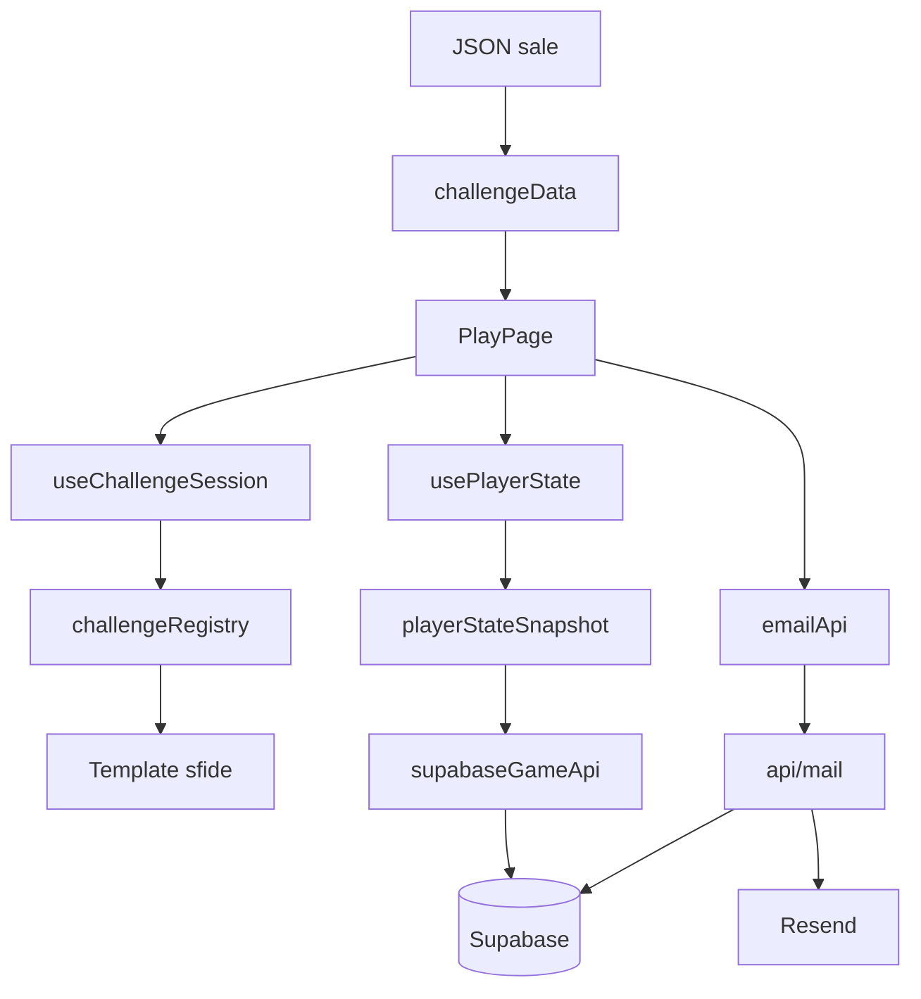

# Architettura e mappa del codice

## Sistema

La Mostra delle Ombre Illuminate è un web game narrativo per un regalo di laurea. SPA React con accesso tramite codice personale, sale tematiche, sfide multimediali, crediti, artefatti e premi. Il pacchetto si chiama `il-regalo`.

Stack da `package.json`: React 19, React Router 7, Vite 8, Tailwind CSS 4, Supabase JS 2, Resend 6. Sono versioni dichiarate, non un'indicazione delle ultime versioni disponibili.

Le risposte corrette sono incluse nei dati distribuiti al browser; la valutazione delle sfide avviene nel client.

## Route

Fonte: `src/App.jsx`; il provider è montato da `src/main.jsx`.

| Route | Comportamento | Accesso |
| --- | --- | --- |
| `/` | `HomePage`: ingresso e introduzione VIP | Pubblico |
| `/bridge` | `BridgePage`: passaggio narrativo | Autenticato |
| `/shadows` | `ShadowHallPage`: hub, porte e artefatti | Autenticato |
| `/map` | Redirect a `/shadows` | Controllo sulla destinazione |
| `/play/:categoryId` | `PlayPage`: sessione della sala | Autenticato |
| `/dev` | `DevPage`: strumenti amministrativi | Ruolo admin |

La protezione attende l'idratazione prima di controllare la sessione. I controlli UI non sostituiscono le autorizzazioni backend. `DashboardPage.jsx` esiste ma non è collegata al router corrente.

## Responsabilità

| File/cartella | Responsabilità |
| --- | --- |
| `src/data/categories/*.json`, `index.js` | Contenuti raw: sale, sfide, zone, costi, narrazione e premi |
| `src/lib/challengeData.js` | Normalizzazione dei dati, default, alias e percorsi asset |
| `src/types/challenge.d.ts` | Contratti delle sfide, categorie, draft, runtime e giocatore |
| `src/lib/challengeRegistry.js` | Tipi, renderer, valutatori, feedback e soluzioni |
| `src/lib/answerNormalization.js` | Matching delle risposte e valutazione condivisa |
| `src/lib/challengeDraftState.js` | Inizializzazione input e stato runtime |
| `src/hooks/useChallengeSession.js` | Sfida corrente, risposte, risultati, avanzamento e ripresa |
| `src/pages/PlayPage.jsx` | Regia: zone/sottogiochi, indizi, esiti, premi, email |
| `src/hooks/usePlayerState.js` | Login, bootstrap, crediti, limiti, sblocchi, persistenza, archivi, admin |
| `src/lib/playerStateSnapshot.js` | Default, normalizzazione e payload di progresso/giornalieri/archivi |
| `src/lib/playerSaveQueue.js` | Salvataggi serializzati, ricevute idempotenti, revisioni e isolamento tra login |
| `src/components/admin/`, `src/lib/adminOperations.js` | Impostazioni admin, anteprime, piani di reset e ripristino, storico economico |
| `src/lib/supabaseClient.js`, `supabaseGameApi.js` | Configurazione e accesso al backend |
| `src/lib/challengeRewards.js` | Crediti, scoring per gruppi, sottopremi e statistiche |
| `src/lib/roomTransitions.js` | Passaggi musica → serie-film → cura-corpo |
| `src/components/challenges/templates/` | UI dei singoli tipi di sfida |
| `src/components/challenges/common/` | Componenti condivisi dei template |
| `src/components/music-room/` | Layout, mappa, modali, personaggi; nome storico usato anche per altre sale |
| `src/components/home/` | Ingresso VIP e narrazione introduttiva |
| `useBackgroundAudio`, `useFearEffects`, `useCharacterComments` | Audio, paure e commenti narrativi |
| `src/lib/emailApi.js`, `api/mail/` | Fetch client, controlli server, HTML email, Resend e tracking |
| `public/` | Asset serviti tramite percorsi dalla radice |

## Stato e salvataggi

Lo stato iniziale comprende `version`, `credits`, `stats`, `roomProgress`, `unlockedCategoryIds`, `currentRoom`, `currentChallengeId`, `activeSession`, `transitionState`, `rewardState` ed `emailState`. La sala inizialmente sbloccata è `musica`. Default giornalieri: 3 tentativi quiz e 2 vite (`playerStateSnapshot.js`); controllare anche sessione e backend prima di cambiare il significato dei contatori.

localStorage conserva `path-to-graduation:access-code`, `path-to-graduation:music-enabled` e `path-to-graduation:vip-access`. Il progresso passa invece dalle RPC Supabase. Il flag VIP è un passaggio di presentazione, non una prova di autenticazione server.

Il provider aggiorna stato React e ref, poi salva immediatamente o con debounce attraverso una coda seriale. Gli errori di sincronizzazione sono esposti con `syncError` e un avviso globale; i conflitti di revisione bloccano ulteriori scritture dalla scheda. La sessione attiva conserva draft/runtime e risultati per la ripresa; evitare aggiornamenti che saltino questo percorso.

Dal 17 novembre 2026 lo stato include `stateRevision` e ogni movimento di crediti è salvato con il progresso. Gli archivi nuovi sono inclusi nella stessa transazione. I reset passano esclusivamente dal pannello admin e conservano checkpoint prima/dopo; vedere [gestione amministrativa](GESTIONE_ADMIN.md). `introSeen` distingue la narrazione dal timestamp di inizio, mantenendo il fallback per i vecchi salvataggi.

Le stanze concluse hanno riepiloghi e snapshot di dettaglio. `buildRoomArchivePayload` costruisce l'archivio, `buildProgressPayload` può alleggerire il progresso quando esiste il dettaglio archiviato, `loadRoomArchive` recupera il dettaglio. Nel provider esistono fallback per backend privi delle RPC archivi: non assumere che la migration sia già applicata ovunque.

## Pipeline e scoring

JSON → normalizzazione → draft/runtime → template → valutazione → feedback → aggiornamento sessione → crediti/esito → salvataggio.

Il registro dichiara 19 tipi: `multiple_choice`, `free_text`, `ordering`, `multi_stage_progressive_reveal`, `intruder`, `sequence_reconstruction`, `guess_title_author`, `face_morph`, `fill_lyrics`, `musical_chain`, `hitster`, `speedrun_characters`, `image_option_matching`, `column_reorder_matching`, `card_matching`, `memory_palette`, `multi_round_quiz`, `visual_timeline`, `progressive_clue_rounds`.

`type` sceglie UI e valutazione; `quizSubType` classifica il contenuto nei gruppi. Non sono sinonimi.

| Sala | Sfide | Criterio corrente |
| --- | --- | --- |
| `musica` | 12 | Almeno 8 corrette; vittoria anche anticipata in `PlayPage` |
| `serie-film` | 39, in 13 gruppi | Soglia sala 0,6; gruppo predefinito 0,7, con override |
| `cura-corpo` | 12, in 12 gruppi | Soglia sala 0,6: 8 giochi superati; gruppo 1 sull'esito della prova |

`computeWeightedRoomScore` assegna il peso del gruppo se superato, zero altrimenti, e divide per il peso totale. Non è la media dei punti grezzi delle risposte. Con i pesi correnti pari a 1 servono 8 gruppi su 13 per serie-film e 8 su 12 per cura-corpo. I sottopremi hanno condizioni autonome; nelle famiglie viene mantenuto il tier più alto ottenuto. Cura-corpo non ha sottopremi attivi: ha un solo regalo Kodak Charmera, distinto dall'artefatto narrativo. Non dedurre la soglia musica dal fallback generico dello scoring: la regola operativa è in `PlayPage`.

Revisione cura-corpo del 16 novembre: round bloccati e cursore sono nel draft, scadenze assolute e rivelazioni nel runtime. `SequentialRoundChallenge` e `evaluateVisualRound` condividono feedback e validazione; effetti, supporti e timeline conservano un invio unico. Dettagli e compatibilità nella [nota d'implementazione](IMPLEMENTAZIONE_CORPO_MODA_FOTO.md).
